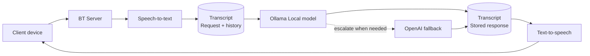

# BT

BT is a local-first, voice-native personal assistant with a personality inspired by BT-7274 from *Titanfall 2*. It runs a conversational core locally through Ollama, keeps transcripts in SQLite, and can escalate a turn to OpenAI when asked or when the local response fails.

This repository contains a FastAPI server with text chat, an optional voice pipeline, and a browser client for foreground use on macOS and iOS. See [the design document](docs/DESIGN.md) for the architecture, routing policy, and future direction.

## Architecture



## Current status

The text conversational core is ready for development use. The voice pipeline is available behind an opt-in setting.

- [x] Local chat through Ollama
- [x] Local-first routing with an optional OpenAI fallback
- [x] SQLite-backed session transcripts
- [x] Optional speech-to-text and text-to-speech pipeline
- [x] Developer dashboard for live transcripts
- [x] Browser client with typed chat, push-to-talk, saved sessions and reconnect
- [x] Open HTTP and WebSocket access inside the tailnet, with a same-origin check
- [x] NixOS service module and daily transcript backups
- [ ] Native apps and external integrations

OpenAI fallback has not yet been fully tested end-to-end.

## Requirements

- Python 3.11 or later
- [uv](https://docs.astral.sh/uv/)
- [Ollama](https://ollama.com/) running locally
- An Ollama chat model that matches `BT_OLLAMA_MODEL`

Voice mode also needs FFmpeg, PortAudio, and Piper. The Nix development shell provides these dependencies.

## Quick start

### NixOS / Nix

Enter the development shell and install the Python dependencies:

```sh
nix develop ./nix
uv sync
```

Ensure the Ollama service is running, then pull a model. For example:

```sh
ollama pull qwen2.5:14b
```

Create your local configuration and set the model to the one you pulled:

```sh
cp .env.example .env
```

In `.env`, add:

```dotenv
BT_OLLAMA_MODEL=qwen2.5:14b
```

Start BT:

```sh
uv run bt
```

### Other systems

Install the system dependencies required by the features you intend to use, then install the project dependencies:

```sh
uv sync
```

Install and start Ollama, pull a model, and configure BT as above:

```sh
ollama pull qwen2.5:14b
cp .env.example .env
```

Set `BT_OLLAMA_MODEL=qwen2.5:14b` in `.env`, then run:

```sh
uv run bt
```

## Using BT

`uv run bt` starts the service on `http://127.0.0.1:8080`. Confirm it is available with:

```sh
curl http://127.0.0.1:8080/health
```

Send a text turn to the chat API:

```sh
curl http://127.0.0.1:8080/chat \\
  -H 'content-type: application/json' \\
  -d '{"text":"Hello, BT."}'
```

The response includes a `session_id`; pass it back as `session_id` in later requests to continue that conversation. BT records the input and response, along with the provider that answered, in its SQLite transcript database.

For a development server on port 8081, run:

```sh
uv run bt-dev
```

To enable the developer dashboard, set either `BT_DEVELOPER_MODE=1` or `BT_DEVUI=1` in `.env`, then open `/dev` on the active server—for example, `http://127.0.0.1:8081/dev` when using `bt-dev`.

## Browser client and full-time server

Open `/` on the running server. BT has no login: anyone who can reach it on your tailnet can use it, so it only binds to loopback or a Tailscale address. Requests from another website's origin are rejected. Native clients that send no `Origin` header are accepted.

The client supports typed chat, saved conversations, foreground push-to-talk and automatic reconnect after a network drop. Voice needs `BT_VOICE=1` and HTTPS or localhost for microphone access. One device can use voice at a time. End voice to type in that conversation. The header and sidebar show server, model and voice connection status.

For the NixOS service, private Tailscale HTTPS, backup/restore steps and deployment checks, follow [the deployment guide](docs/DEPLOYMENT.md). The service remains bound to loopback behind Tailscale Serve. Developer mode is not needed by the browser client.

`GET /health` reports process availability. Authenticated `GET /ready` checks storage, Ollama reachability and the installed model. Run one server process; conversation leases are process-local.

## Configuration

Copy [.env.example](.env.example) to `.env`; all options have sensible defaults unless noted otherwise.

| Setting | Purpose | Default |
| --- | --- | --- |
| `BT_OLLAMA_URL` | Ollama server URL | `http://127.0.0.1:11434` |
| `BT_OLLAMA_MODEL` | Local chat model | `qwen3:8b` |
| `OPENAI_API_KEY` | Enables cloud escalation | none |
| `BT_OPENAI_MODEL` | Cloud fallback model | `gpt-5.6-luna` |
| `BT_HOST` | Server bind address (see [Remote access](#remote-access-over-tailscale)) | `127.0.0.1` |
| `BT_DB_PATH` | SQLite transcript database path | `bt.sqlite3` |
| `BT_VOICE` | Enable voice mode when set to `1` | off |
| `BT_DEVELOPER_MODE` | Enable developer tooling and dashboard when set to `1` | off |
| `BT_DEVUI` | Enable only the developer dashboard when set to `1` | off |

`bt-dev` loads `.env.dev` before `.env`, so it is useful for local development overrides. Shell environment variables take precedence over either file.

## Model routing

BT normally uses Ollama. It escalates to the configured OpenAI model when you explicitly ask it to “think harder,” “use your best model,” or “escalate,” and also when the local response is malformed or the Ollama request fails. Configure `OPENAI_API_KEY` before relying on this fallback.

## Project layout

- `bt/client/` — browser chat, push-to-talk and saved conversations
- `bt/gateway/` — HTTP gateway, same-origin check and health endpoints
- `bt/llm/` — local/cloud model routing
- `bt/voice/`, `bt/stt/`, and `bt/tts/` — optional voice pipeline
- `bt/transcript/` — SQLite-backed sessions and turns
- `bt/personality/SOUL.md` — personality source used to build the system prompt
- `docs/DESIGN.md` — design decisions and phase-two ideas

## Verification

```sh
uv run pytest -q
node --test tests/*.test.mjs
```

These checks use temporary databases and fake provider responses. They do not invoke paid models. Real voice, NixOS service behavior and iPhone audio still need device validation.
