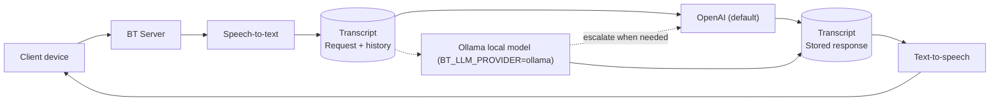

# BT

BT is a voice-native personal assistant with a personality inspired by BT-7274 from *Titanfall 2*. It answers through OpenAI by default and keeps transcripts in SQLite. Set `BT_LLM_PROVIDER=ollama` to run the model locally through Ollama instead; in that mode BT escalates a turn to OpenAI when asked or when the local response fails.

This repository is a monorepo. `server/` holds the FastAPI server with text chat, an optional voice pipeline, and a browser client for foreground use on macOS and iOS. `apple/` holds the native macOS app shell and shared Swift package. Editor plugins (`editors/`) are planned; see [the monorepo plan](docs/superpowers/plans/2026-10-19-monorepo-and-mac-client.md). See [the design document](docs/DESIGN.md) for the architecture, routing policy, and future direction.

## Architecture



## Current status

The text conversational core is ready for development use. The voice pipeline is available behind an opt-in setting.

- [x] Chat through OpenAI by default, or locally through Ollama
- [x] Ollama mode with an optional OpenAI fallback
- [x] SQLite-backed session transcripts
- [x] Optional speech-to-text and text-to-speech pipeline
- [x] Developer dashboard for live transcripts
- [x] Browser client with typed chat, push-to-talk, saved sessions and reconnect
- [x] Open HTTP and WebSocket access inside the tailnet, with a same-origin check
- [x] NixOS service module and daily transcript backups
- [x] Native macOS app shell and tool sidebar (`apple/`)
- [ ] Native chat, productivity tools and voice
- [ ] Native iOS app with equal capabilities to macOS client.
- [ ] External integrations

## Requirements

- Python 3.11 to 3.14 (`ctranslate2` has no 3.15 wheels yet; use `uv sync --python 3.14` if uv picks a newer one)
- [uv](https://docs.astral.sh/uv/)
- An OpenAI API key in `OPENAI_API_KEY`, for the default OpenAI mode
- For Ollama mode only: [Ollama](https://ollama.com/) running locally and a chat model that matches `BT_OLLAMA_MODEL`

Voice mode also needs FFmpeg, PortAudio, and Piper. The Nix development shell provides these dependencies.

## Quick start

Run every command in this section and the next from `server/`.

### NixOS / Nix

Enter the development shell and install the Python dependencies:

```sh
nix develop ./nix
uv sync
```

For Ollama mode, ensure the Ollama service is running, then pull a model. Skip this if you use OpenAI. For example:

```sh
ollama pull qwen2.5:14b
```

Create your local configuration:

```sh
cp .env.example .env
```

In `.env`, set your OpenAI key, or switch to Ollama and name the model you pulled:

```dotenv
OPENAI_API_KEY=sk-...
# or
BT_LLM_PROVIDER=ollama
BT_OLLAMA_MODEL=qwen2.5:14b
```

Start BT:

```sh
uv run bt
```

### Other systems

Install the system dependencies required by the features you intend to use, then install the project dependencies:

```sh
uv sync
```

Copy the configuration and fill it in as above. For Ollama mode, also install and start Ollama and pull a model:

```sh
cp .env.example .env
ollama pull qwen2.5:14b
```

Then run:

```sh
uv run bt
```

## Using BT

`uv run bt` starts the service on `http://127.0.0.1:8080`. Confirm it is available with:

```sh
curl http://127.0.0.1:8080/health
```

Send a text turn to the chat API:

```sh
curl http://127.0.0.1:8080/chat \\
  -H 'content-type: application/json' \\
  -d '{"text":"Hello, BT."}'
```

The response includes a `session_id`; pass it back as `session_id` in later requests to continue that conversation. BT records the input and response, along with the provider that answered, in its SQLite transcript database.

For a development server on port 8081, run:

```sh
uv run bt-dev
```

To enable the developer dashboard, set either `BT_DEVELOPER_MODE=1` or `BT_DEVUI=1` in `.env`, then open `/dev` on the active server—for example, `http://127.0.0.1:8081/dev` when using `bt-dev`.

## Browser client and full-time server

Open `/` on the running server. BT has no login: anyone who can reach it on your tailnet can use it, so it only binds to loopback or a Tailscale address. Requests from another website's origin are rejected. Native clients that send no `Origin` header are accepted.

The client supports typed chat, saved conversations, foreground push-to-talk and automatic reconnect after a network drop. Voice needs `BT_VOICE=1` and HTTPS or localhost for microphone access. One device can use voice at a time. End voice to type in that conversation. The header and sidebar show server, model and voice connection status.

For the NixOS service, private Tailscale HTTPS, backup/restore steps and deployment checks, follow [the deployment guide](docs/DEPLOYMENT.md). The service remains bound to loopback behind Tailscale Serve. Developer mode is not needed by the browser client.

`GET /health` reports process availability. Authenticated `GET /ready` checks storage. In Ollama mode it also checks that Ollama is reachable and the model is installed. In OpenAI mode it checks only that the provider is configured; it does not call OpenAI, so a bad key or missing model access shows up on the first reply. Run one server process; conversation leases are process-local.

## Native macOS client

Open `apple/BT.xcodeproj`, select the `BTMac` scheme and run it. The app requires macOS 14 or later and Xcode with Swift 6 support. It currently shows the tool sidebar and a BT placeholder; it does not connect to the server yet.

See [apple/README.md](apple/README.md) for terminal build commands, package tests and the module contract.

## Configuration

Copy [server/.env.example](server/.env.example) to `server/.env`; all options have sensible defaults unless noted otherwise.

| Setting | Purpose | Default |
| --- | --- | --- |
| `BT_LLM_PROVIDER` | Primary model provider, `openai` or `ollama` | `openai` if `OPENAI_API_KEY` is set, otherwise `ollama` |
| `BT_OLLAMA_URL` | Ollama server URL | `http://127.0.0.1:11434` |
| `BT_OLLAMA_MODEL` | Local chat model | `qwen3:8b` |
| `OPENAI_API_KEY` | Required in OpenAI mode; enables escalation in Ollama mode | none |
| `BT_OPENAI_MODEL` | OpenAI model | `gpt-5.6-luna` |
| `BT_HOST` | Server bind address (see [Remote access](#remote-access-over-tailscale)) | `127.0.0.1` |
| `BT_DB_PATH` | SQLite transcript database path | `bt.sqlite3` |
| `BT_VOICE` | Enable voice mode when set to `1` | off |
| `BT_DEVELOPER_MODE` | Enable developer tooling and dashboard when set to `1` | off |
| `BT_DEVUI` | Enable only the developer dashboard when set to `1` | off |

`bt-dev` loads `.env.dev` before `.env`, so it is useful for local development overrides. Shell environment variables take precedence over either file.

## Model routing

`BT_LLM_PROVIDER` picks the model for both text and voice. It is read at startup, so restart BT after changing it. Case and surrounding spaces are ignored. If it is unset, BT uses OpenAI when `OPENAI_API_KEY` is set and Ollama when it is not, so an existing Ollama-only install keeps working after an upgrade. BT refuses to start if the value is not `openai` or `ollama`, or if OpenAI mode has no `OPENAI_API_KEY`.

In OpenAI mode every turn goes to the configured OpenAI model. If OpenAI fails, the request fails; BT does not fall back to Ollama.

In Ollama mode BT answers locally and escalates to OpenAI when you ask it to "think harder," "use your best model," or "escalate," or when the local response is malformed or the Ollama request fails. Escalation needs `OPENAI_API_KEY`. This mode is not a privacy mode: escalated turns still go to OpenAI.

## Project layout

- `server/` — Python backend (`pyproject.toml`, `uv.lock`, `tests/`, `nix/`)
- `apple/BTKit/` — shared Swift package with the module contract and tool sidebar
- `apple/BTMac/` — macOS app entry point and sandbox entitlements
- `server/bt/client/` — browser chat, push-to-talk and saved conversations
- `server/bt/gateway/` — HTTP gateway, same-origin check and health endpoints
- `server/bt/llm/` — local/cloud model routing
- `server/bt/voice/`, `server/bt/stt/`, and `server/bt/tts/` — optional voice pipeline
- `server/bt/transcript/` — SQLite-backed sessions and turns
- `server/bt/personality/SOUL.md` — personality source used to build the system prompt
- `docs/DESIGN.md` — design decisions and phase-two ideas

## Verification

From `server/`:

```sh
uv run python -m pytest -q
node --test tests/*.test.mjs
```

These checks use temporary databases and fake provider responses. They do not invoke paid models. Real voice, NixOS service behavior and iPhone audio still need device validation.
